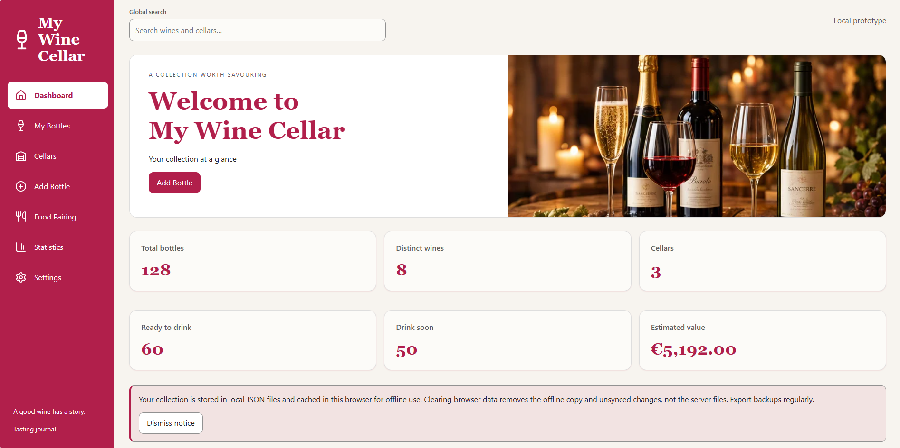

# My Wine Cellar



Local, anonymous React/TypeScript SPA with Node.js REST APIs and an atomic JSON-file repository. Implements the supplied functional requirements and the accompanying 52-scenario test plan. The supplied mock-ups guide the layouts, imagery and typography; the warm Clawpilot theme provides light, dark and high-contrast variants.

## Run locally

Requires Node.js 22 or later. From this directory:

```powershell
npm install
npm run build
npm start
```

Open **http://127.0.0.1:3001**. The first run creates a clearly illustrative collection of 128 bottles in three cellars. You can remove it through Settings, which requires two confirmations. It is not recreated after deletion.

For an empty first run, use a separate data directory:

```powershell
$env:EMPTY_COLLECTION = '1'
$env:DATA_DIR = 'empty-data'
npm start
```

Development: `npm run dev`, then open http://127.0.0.1:5173. The production build is required for offline installation. `PORT` overrides the API/production port; development expects port 3001.

## Data and offline use

- `data\collection.json` contains the entire collection and idempotency receipts. Photos are resized/compressed data URLs, included in full JSON backups. No database, login, external service, tracking cookie or remote image request is needed.
- Use Settings to export/restore full backups or import CSV with column mapping, per-row validation and valid-only import. CSV does not include photos or history; use full backup for a complete round-trip.
- JSON writes are serialised, flushed and atomically renamed. Invalid requests, corrupt backups, occupied-cellar deletion and conflicting revisions cannot partially overwrite the collection.
- The production service worker caches the application. IndexedDB stores its offline copy and pending commands. Visit once online before using it offline. Edits are replayed when connectivity returns; duplicate request IDs cannot apply an opening twice.
- A sync conflict is **not** automatically merged or overwritten. Export the local recovery backup before choosing to reload server data. Browser storage clearing removes unsynced changes; server JSON files remain intact.
- This is one local collection, shared by browsers connected to this local server, not a multi-user system. Bindings are loopback-only. Do not expose this anonymous prototype publicly.

## Features

Dashboard indicators, alerts, cellar CRUD and readings, rack views, complete bottle forms, archive/restore, quantity controls, moves, duplicates, grid/table inventory, search/filter/sort/pagination, bulk actions, offline food pairing and personal preferences, opening history/undo and tasting journal, accessible statistical tables, CSV/PDF export, backup/restore, configurable lists, English/Italian preferences and accessibility settings.

Temperatures are stored in Celsius; Fahrenheit changes presentation only. Capacity and unsuitable-temperature warnings permit a deliberate save. Drinking status is Too young before `drinkFrom`, Past peak after `drinkBy`, Drink soon in its final two calendar years, otherwise Ready. A missing price/value contributes zero to the estimated collection value.

## Tests and original references

```powershell
npm run check
npm test
npm run build
npx playwright install chromium
npm run test:e2e
npm run format:check
```

Vitest exercises validation, business rules, CSV, backups, persistence, atomic failures, concurrency and idempotency. Playwright exercises the real production SPA, including accessibility scans, mobile reflow, offline reload/synchronisation, error recovery and the main user journeys. Tests use isolated temporary storage, never the real collection.

`reference\requirements.docx`, `reference\tests.xlsx` and `reference\test-cases.json` preserve the original attachments and all 52 acceptance scenarios. Test names reference their TC identifiers. `npm run test:coverage-map` generates a traceability report without claiming manual scenarios passed.

**Manual acceptance still required:** NVDA/JAWS/VoiceOver/TalkBack, real phone camera and HEIC samples, installation on supported devices, forced-colours inspection, manual contrast/focus review, 200% text resize, cross-browser testing on the latest two supported versions. Automated axe checks alone do not establish WCAG/EN conformance. The accessibility statement records these limitations. PDF exports are readable but not tagged; use the accessible web tables or CSV when needed. Cropping is a central percentage crop with 90-degree rotation. Optional barcode recognition, IoT, online AI enrichment and multi-user sharing are not implemented.

## REST API

| Method | Endpoint                 | Purpose                        |
| ------ | ------------------------ | ------------------------------ |
| GET    | `/api/health`            | Readiness                      |
| GET    | `/api/collection`        | Full snapshot with revision    |
| GET    | `/api/bottles?q=...`     | Search wine entries            |
| GET    | `/api/bottles/:id`       | Wine details and food pairings |
| GET    | `/api/cellars`           | Cellars and physical occupancy |
| GET    | `/api/statistics`        | Collection summary             |
| GET    | `/api/pairings?dish=...` | Reverse dish search            |
| GET    | `/api/backup`            | Complete backup                |
| GET    | `/api/export.csv`        | CSV inventory                  |
| POST   | `/api/commands`          | Transactional mutations        |

Mutation envelope:

```json
{
  "id": "unique-request-id",
  "expectedRevision": 0,
  "date": "2026-11-06T17:00:00.000Z",
  "action": { "type": "quantity", "id": "wine-entry-id", "delta": 1 }
}
```

Actions and their exact schemas live in `shared\commands.ts`: saveBottle, saveCellar, deleteBottles, restoreBottles, deleteCellar, undoCellarDeletion, move, tag, quantity, open, undoOpen, settings, restore, import and clear. Responses return the committed snapshot. Validation uses HTTP 400 with field messages; missing records 404; revision conflicts 409; repository failures 500. Replays of acknowledged commands return the current snapshot without reapplying them.
